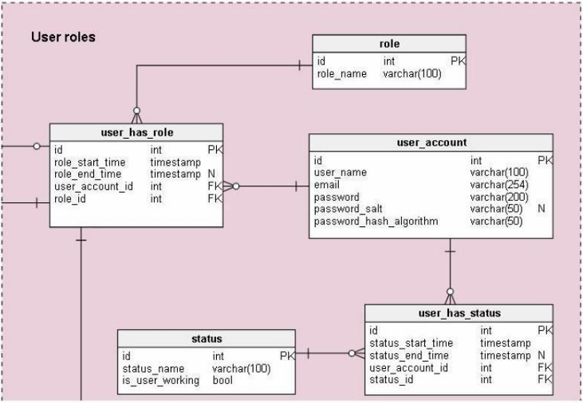

# SQL Projects

A collection of Microsoft SQL Server projects and database assignments.

## Projects

- [Project 01: Querying a Large Relational Database](Project-01/README.md)
  - Uses the AdventureWorks2012 database to practice joins, filtering, aggregation, subqueries, and SQL Server query techniques.

- [Project 02: Relational Database Design](Project-02/README.md)
  - Converts a user-role relational design into SQL Server tables with primary keys, foreign keys, sample data, and data deletion.
  - 

  

